# What Voters Care About, What Markets Price: Topic Sentiment, Event Contracts and the 2026 Midterm Trade

**Study window:** 19 Jul 2025 – 8 Oct 2026 (447 days; Election Day is 3 Nov 2026) · **Corpus:** 257,966 documents (224,495 Bluesky posts and 33,471 news headlines from ≈3,500 outlets) · **Markets:** Polymarket and Kalshi "Democratic sweep" contracts · **Equities:** a 20-stock ex-ante mid-term basket

---

## Executive summary

| Question | Answer | Key evidence |
|---|---|---|
| **What do voters care about?** | **The economy and cost of living** is the voters' priority. The discourse, however, is dominated by **democracy / rule of law** (33% of issue discourse), **redistricting** (20%), **Epstein files / corruption** (11%) and the **Iran war / foreign policy** (8%). The economy gets only 4.9% of the discourse, but that share is rising (7.5% in the last 60 days). | Kalshi's exit-poll market prices "economy & cost of living" at **92%** to be the #1 issue. Our salience ranking agrees with that market's ordering (Spearman **ρ = 0.85**), but understates the economy's *level* by an order of magnitude. Media and activist attention ≠ median-voter priority. |
| **Does topic sentiment track P(Democratic sweep)?** | **Weakly, only at the same moment, and with the "wrong" sign.** Changes in the composite sentiment index correlate with changes in logit P(sweep) at **ρ = 0.10** (daily) and **0.20** (weekly). None of the 10 tests survives a false-discovery-rate correction. More positive tone goes with *higher* Democratic odds, which rejects the referendum ("discontent") hypothesis. | The cross-correlation peaks at lag 0. No Granger causality survives correction. Out-of-sample R² is **0.4%** (Clark–West p = 0.10). Polymarket passes weak-form efficiency tests in the second half of the sample. The sentiment link is concentrated in the **House** contract (ρ = 0.14; redistricting tone 0.15), not the Senate (0.03). |
| **Do mid-term-exposed equities trade on it?** | **Not detectably in this cycle.** The thesis basket (Democratic-sweep beneficiaries minus losers) loaded on the sweep probability in-sample (t = 1.6) but reversed out-of-sample (t = −0.7). A data-driven basket shows textbook overfitting (in-sample t = 3.3 → out-of-sample t = −1.6). The sentiment index has no relationship with basket returns. | 13 of 20 thesis signs are correct (binomial p = 0.13). The event study on the 10 largest probability shocks gives p = 0.41. The political loading after Fama–French 5 + momentum controls has t = 0.83. **Power:** we can only rule out political exposures above about **19% cumulative abnormal return** over the window. |

**Bottom line.** NLP is very good at measuring *what is being talked about* and *how the conversation feels*, and that tone moves on the same news days as the prediction market. But once you observe the event-contract price, sentiment adds essentially no forecasting information. The "midterm trade" in equities was not a priced factor during the campaign. The most defensible economic reason is that **a Democratic Congress facing a Republican president produces gridlock (veto power), not a large policy shift**. The practical implication: use event-contract prices as the political state variable, use NLP to *explain and attribute* their moves, and concentrate the equity test on the election-night resolution, when roughly 1.9 logit units of uncertainty resolve at once.

---

## 1. Problem framing and design choices

The assignment chains three links: **(i)** voter issues → **(ii)** issue sentiment over time ↔ P(Democratic sweep) → **(iii)** sentiment ↔ a mid-term equity basket. Each link has an identification trap, and the design is built around avoiding them:

| Trap | Why it matters | What we did |
|---|---|---|
| *Imposing the answer.* If you search for "inflation" you will find inflation. | Topic prevalence would just reflect the keyword list. | Retrieval queries are **issue-agnostic** ("midterms", "Congress", "voters", …). Issues are **discovered** by an unsupervised topic model and then mapped to a taxonomy. |
| *Attention ≠ concern.* | Volume of discourse measures what media and activists amplify, not what the median voter ranks first. | Salience is **validated externally** against Kalshi's exit-poll issue market. News and engagement-weighted social media are reported separately. |
| *Spurious regression.* | logit P(sweep) has a unit root (ADF p = 0.95); the sentiment indices are stationary (ADF p ≤ 0.02). Level correlations as high as 0.65 are meaningless. | All inference is on **changes**, with HAC errors, block-bootstrap confidence intervals and Benjamini–Hochberg FDR control. Levels are shown only descriptively. |
| *Asynchronous clocks.* | Polymarket's daily print is stamped 00:00 UTC, i.e. the *previous* day's close. Equities close at 16:00 ET. Sentiment days run in UTC. | Each market series is re-labelled to the day it closes. Hourly market data is sampled at **16:00 ET** for the equity tests. The sentiment regressor for equities is lagged so it sits inside the return interval. *(Catching the first of these turned a spurious "predictive" result into a correct contemporaneous one; see §4.4.)* |
| *Look-ahead and data-snooping.* | The basket and its signals must be fixed before outcomes are observed. | Betas are estimated on a pre-period (Jul 2024 – Jul 2025). The basket is **ex-ante, thesis-driven**. The data-driven variant is formed in-sample and evaluated **out-of-sample** (split on 1 Mar 2026). |

Four hypotheses were written down before looking at the correlation results:

* **H1 (referendum).** Under a Republican trifecta, a worsening tone on issues raises P(Democratic sweep): corr(ΔI, ΔlogitP) < 0.
* **H2 (efficiency).** Sentiment co-moves with event-contract prices but does **not** forecast them out-of-sample.
* **H3 (political beta).** Thesis beneficiaries (losers) earn positive (negative) market-adjusted returns when P(sweep) rises.
* **H4 (sentiment → equities).** The sentiment index explains basket returns over and above the prediction market.

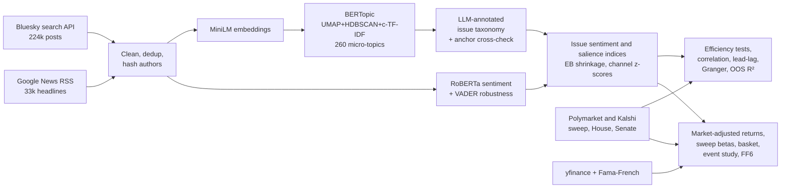

---

## 2. Data

| Source | What it gives | N | Why this source | Main caveat |
|---|---|---|---|---|
| **Bluesky** public search (`app.bsky.feed.searchPosts`) | Posts with engagement counts; `since`/`until` allow true historical windows | 224,495 after deduplication (6 queries × 447 days × ≤100 "top" posts) | The only large public social API that is still free and **time-sliceable** (X, Reddit and Pushshift are closed or paid) | Strong **left-leaning** user base; `sort=top` favours viral posts |
| **Google News RSS** (`after:`/`before:` operators) | Headlines and outlet names | 33,471 after deduplication (5 queries × 3-day windows) | A free historical aggregator across the ideological spectrum (top outlets include The Hill, NYT, PBS, Politico, Reuters, NBC, Fox, …) | Headlines only; the ranking algorithm is opaque |
| **Polymarket** CLOB (daily and hourly) | "D Senate, D House" balance-of-power contract; ≈$21M event volume | 430 daily changes | The longest and most liquid sweep contract | Crypto-native participants; thin books early on |
| **Kalshi** (daily and hourly candles) | "Democrats sweep" (`KXBALANCEPOWERCOMBO-27FEB-DD`), D House, D Senate; exit-poll issue market | 301 / 446 / 446 | CFTC-regulated venue; lets us split the chambers | Last-trade prints suffer bid-ask bounce, so **mid-quotes** are used |
| **yfinance** | Adjusted closes for 20 stocks, SPY and sector ETFs | Jul 2024 – Oct 2026 | — | — |
| **Ken French library** | FF5 + momentum, daily | Data through 31 Aug 2026 | Factor robustness | Ends ~5 weeks before the window does |

All author identifiers are SHA-256 hashed at ingestion. Raw text is not committed to the repository; `python run_all.py` rebuilds it.

---

## 3. What voters care about: topic discovery

### 3.1 Model choice

Following the evaluation agenda of Kherwa & Bansal (2019), which covers coherence, diversity and the *stability* problem they flag in §8.4, three model families were compared on the same 40k-document sample. For BERTopic, the 30 largest topics were used.

| Model | K | NPMI | C_v | Diversity | Seed stability (Jaccard of top-10 terms) |
|---|---|---|---|---|---|
| LDA | 10 / 20 / 30 | 0.018 / 0.010 / −0.005 | 0.43 / 0.42 / 0.42 | 0.65–0.68 | **0.23–0.28** |
| NMF | 10 / 20 / 30 | 0.099 / 0.076 / 0.048 | 0.59 / 0.54 / 0.51 | 0.78–0.91 | 0.71–0.82 |
| **BERTopic** | 30 (of 260) | 0.053 | 0.57 | **0.99** | 0.67 (ARI of partitions **0.92**) |

LDA's bag-of-words generative assumption breaks down on 1–3 sentence documents, and its topics are close to arbitrary across random seeds (Jaccard ≈ 0.25). NMF is coherent but coarse. **BERTopic** works on contextual embeddings (`all-MiniLM-L6-v2` → 5-d UMAP → HDBSCAN → class-based TF-IDF). It matches NMF on coherence at equal K, produces almost non-overlapping topics, and is stable across seeds (adjusted Rand index 0.92). It was therefore chosen. HDBSCAN produced **260 micro-topics** and left 36% of documents as outliers. Outliers were reassigned to the nearest topic centroid only when cosine similarity was at least 0.50, which leaves 5.0% unassigned. Rankings are essentially unchanged when only the originally clustered documents are used (see the "clustered-only" column below).

### 3.2 From micro-topics to a voter-issue taxonomy (the "super-intelligence" step)

Micro-topics are often events ("Fulton County FBI raid", "Prop 50") rather than issues. Each of the 260 topics was mapped to one of 17 issues, or to three **non-issue** buckets (horse race / campaign meta, partisan insults / other, non-US / off-topic). The mapping was done by an **LLM annotator (Claude)** reading each topic's c-TF-IDF terms and four centroid-nearest documents. The map, with notes on every judgement call, is version-controlled in [`results/topic_issue_map.csv`](results/topic_issue_map.csv).

To check this step without a human in the loop, a fully automatic **embedding-anchor** classifier was built (cosine similarity of each topic centroid to a natural-language definition of each issue). On substantive topics the two methods agree with **Cohen's κ = 0.59**, and on **76%** of documents. Most disagreements are cases where the anchor method misreads "Congress must check the executive" as a *budget* topic. Non-issue buckets account for **50%** of all documents and are excluded from salience shares. This matters: *horse-race talk is the single largest "topic" in election discourse.*

### 3.3 Result: issue salience

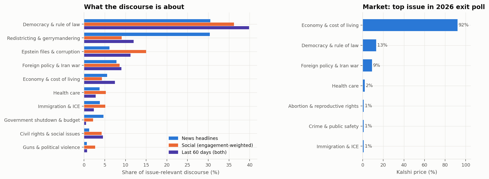

| Issue | News % | Social % (engagement-weighted) | **Salience** | Last 60 days | Clustered-only |
|---|---|---|---|---|---|
| Democracy & rule of law | 30.5 | 36.2 | **33.4** | 39.8 | 27.9 |
| Redistricting & gerrymandering | 30.4 | 9.1 | **19.7** | 12.0 | 20.6 |
| Epstein files & corruption | 6.1 | 15.0 | **10.5** | 11.3 | 11.3 |
| Foreign policy & Iran war | 7.8 | 8.6 | **8.2** | 9.0 | 9.1 |
| Economy & cost of living | 5.5 | 4.3 | **4.9** | **7.5** ↑ | 4.6 |
| Health care | 3.8 | 5.3 | **4.5** | 2.8 | 5.6 |
| Immigration & ICE | 3.8 | 5.1 | **4.5** | 2.4 | 5.5 |
| Government shutdown & budget | 4.7 | 2.2 | **3.4** | 0.5 | 4.1 |
| *(next: civil rights 2.7, guns/political violence 1.7, AI/data centers 1.5 ↑, climate 1.3, Social Security 1.1, tariffs 0.9, abortion 0.7)* | | | | | |

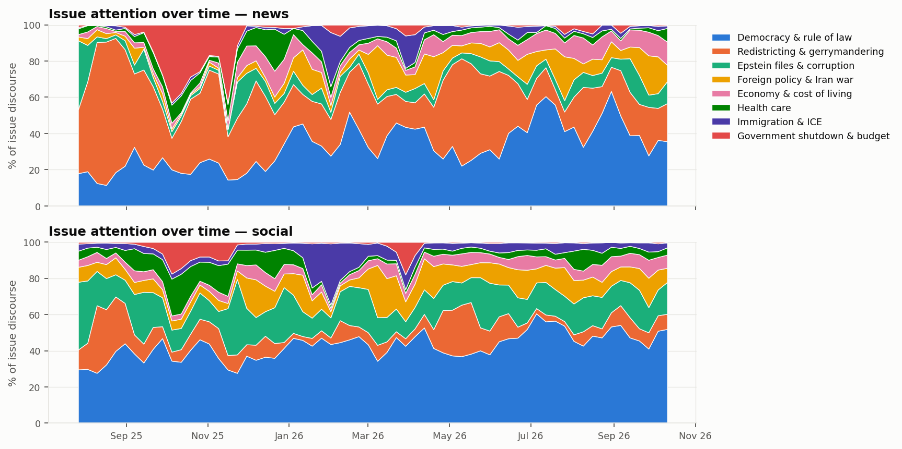

**Interpretation.**

1. **The ordering is externally valid; the levels are not.** Across the seven issues Kalshi lists, our ranking correlates with the exit-poll market at ρ = 0.85, and news and social shares agree with each other (ρ = 0.88). But the market prices the economy at 92%, while the economy holds only 5–7% of the discourse. The discourse over-indexes on **process and scandal** (democracy, maps, Epstein): a highly engaged, left-leaning online audience and political journalists care about these, while the median voter ranks pocketbook issues first. This is the classic attention–priority wedge. Text volume is a biased estimator of issue importance and has to be **calibrated** (here, to a market). Adding the dispersed pocketbook fragments (economy, tariffs, Social Security, health-care premiums, shutdown) gives a "pocketbook bloc" of **≈15%**, which is still far below what the market implies.
2. **News and social media emphasise different things.** Redistricting is a *news* story (30% of headlines: the Texas walkout, California's Prop 50, Missouri, Virginia, the VRA *Callais* ruling). Epstein is a *social* story (15% of social media vs 6% of news).
3. **Dynamics.** The shutdown dominated Oct–Nov 2025 and then vanished. Immigration/ICE spiked in Feb–Mar 2026. In the final 60 days the **economy (5% → 7.5%) and AI/data centers (1.5% → 3.8%)** are rising, consistent with an electorate moving to kitchen-table issues as Election Day nears.

---

## 4. Topic sentiment indices and the Democratic-sweep probability

### 4.1 Index construction

Each document gets a score $s_i = P(\text{pos}) - P(\text{neg})$ from `cardiffnlp/twitter-roberta-base-sentiment-latest`. RoBERTa was chosen rather than FinBERT because the text is political social media, not financial disclosures: domain match dominates (Du et al., 2025, §3.1). For channel *c*, issue *k* and day *t*:

$$
\tilde S_{kct}=\frac{\sum_i w_i s_i + n_0\,\mu_{kc,t-1}}{\sum_i w_i + n_0},\qquad w_i = 1+\log(1+\text{likes}_i+\text{reposts}_i),\; n_0=20
$$

This is empirical-Bayes shrinkage toward the **expanding (past-only)** mean, so thin days are pulled toward the prior with no look-ahead. Engagement weights are log-damped so that a single viral post cannot drive a whole day. Each channel series is z-scored *separately*. This step is essential because Bluesky's level is far more negative than the headlines' (mean document score −0.43 on social media vs −0.12 in headlines), and a pooled index would mostly measure channel mix. The two channel z-scores are then averaged into the issue index $I_{kt}$. The **Midterm Sentiment Index (MSI)** is $\sum_k \omega_k I_{kt}$, with weights $\omega_k$ equal to each issue's share of voice in the **formation period only** (democracy 0.39, Epstein 0.19, redistricting 0.12, health care 0.08, foreign policy 0.08, immigration 0.07, economy 0.04, shutdown 0.04). A smoothed version (EWMA, half-life 3 days) is used for charts and levels. The **unsmoothed** version is used for all change-based inference, because smoothing a series and then differencing it smears each day's shock over neighbouring days.

*Validation.* At the document level, RoBERTa and VADER correlate at ρ = 0.47, which is typical for a contextual model versus a lexicon on sarcastic social text. At the index level they correlate at 0.49–0.61 for the main issues. The headline results below are re-estimated with VADER in §4.5.

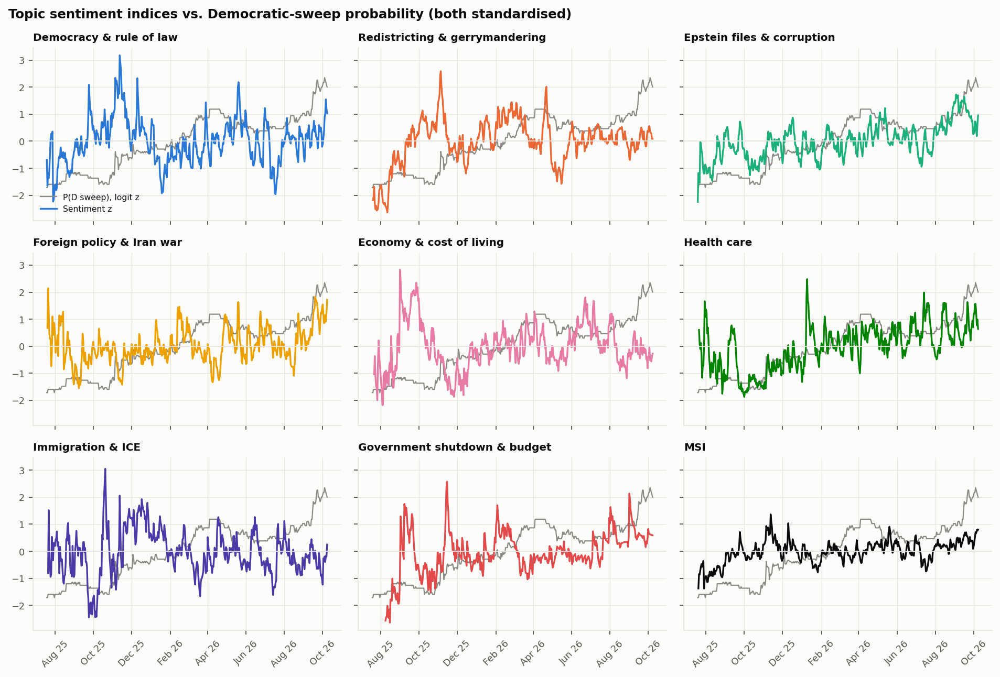

### 4.2 The target: is the prediction market a credible state variable?

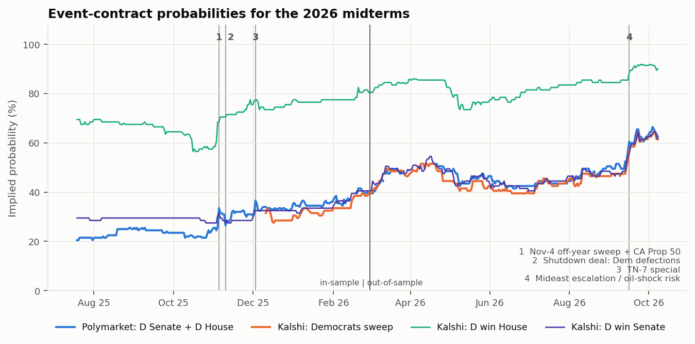

P(Democratic sweep) rose from **20.5% to 63.5%** (+1.9 logit units). The level is set by the Senate: P(D House) ≈ 90% and P(D Senate) ≈ 62%, and the sweep contract tracks their product (correlation 0.985). Polymarket and Kalshi agree closely in levels (correlation 0.98, mean gap 2.4 pp). They are much less synchronised day to day (0.39 daily, 0.64 weekly), which is a microstructure effect.

Weak-form efficiency was tested with the same battery Aloosh, Choi & Ouzan (2023) apply to meme stocks:

| Series (Δ logit) | AC(1) | Ljung–Box(5) p | VR(2) p | VR(5) p | Runs p | Bartels p |
|---|---|---|---|---|---|---|
| Polymarket sweep, full | −0.00 | 0.027 | 0.98 | 0.30 | 0.50 | 0.67 |
|   1st half | −0.09 | **0.002** | 0.42 | 0.10 | 0.23 | 0.16 |
|   2nd half | 0.13 | 0.58 | 0.19 | 0.46 | 0.68 | 0.38 |
| Kalshi sweep (mid-quote) | 0.12 | 0.19 | 0.06 | 0.09 | 0.12 | 0.047 |
| Kalshi D House / D Senate | 0.05 / 0.07 | 0.12 / 0.56 | 0.47 / 0.30 | 0.28 / 0.18 | 0.31 / **0.007** | 0.44 / 0.17 |

Polymarket was **not** efficient while it was young and illiquid (first-half Ljung–Box p = 0.002), and **became** weak-form efficient as volume grew: no test rejects in the second half. Kalshi last-trade prints show strong negative autocorrelation (AC(1) = −0.21, a Roll-type bid-ask bounce), which disappears when mid-quotes are used. Mid-quotes still show mild positive autocorrelation and a VR above 1, suggesting slow information diffusion in the smaller, regulated book. **Implication for H2:** in the second half of the sample there is little left for sentiment to forecast.

### 4.3 Results: contemporaneous association

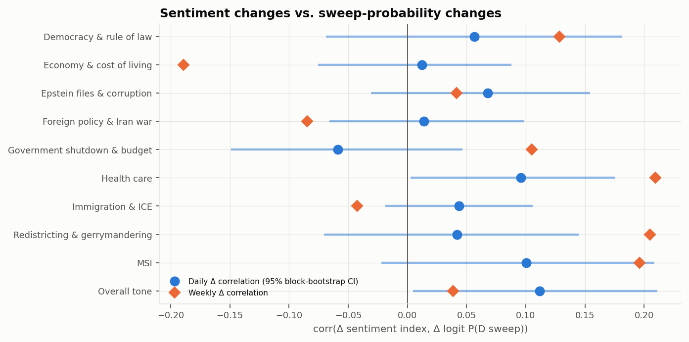

| Index | Level corr *(spurious)* | **Daily Δ corr** [95% block-bootstrap CI] | HAC t | BH q | Weekly Δ corr |
|---|---|---|---|---|---|
| Overall tone | 0.20 | **0.112** [0.005, 0.211] | 1.76 | 0.39 | 0.04 |
| **MSI** | 0.46 | **0.100** [−0.022, 0.209] | 1.38 | 0.39 | **0.196** |
| Health care | 0.65 | 0.096 [0.003, 0.176] | 2.02 | 0.39 | 0.210 |
| Epstein & corruption | 0.64 | 0.068 [−0.031, 0.154] | 1.29 | 0.39 | 0.041 |
| Democracy & rule of law | 0.07 | 0.056 [−0.069, 0.181] | 0.76 | 0.58 | 0.128 |
| Redistricting | 0.24 | 0.042 [−0.071, 0.145] | 0.73 | 0.58 | 0.205 |
| Immigration & ICE | −0.09 | 0.044 [−0.019, 0.106] | 1.39 | 0.39 | −0.043 |
| Foreign policy & Iran war | 0.33 | 0.014 [−0.066, 0.099] | 0.34 | 0.77 | −0.085 |
| Economy & cost of living | 0.02 | 0.012 [−0.075, 0.088] | 0.29 | 0.77 | **−0.189** |
| Shutdown & budget | 0.37 | −0.059 [−0.149, 0.047] | −1.12 | 0.44 | 0.105 |

The weekly sample has 64 observations, so the standard error of a correlation is about 0.125.

**Reading the evidence.**

* **Levels mislead.** Health care and Epstein have level correlations of about 0.65 with P(sweep), but those correlations are just two drifting series. They collapse to 0.07–0.10 in changes.
* **H1 is rejected in sign.** Seven of eight issue indices, and both composites, are *positively* related to Democratic odds. The tone measured on a left-leaning platform and in headlines behaves like a **"Democratic good-news / morale" index**: it improves on days with Democratic special-election wins, court rulings against the administration, or the 4 Nov 2025 off-year sweep. It does not behave like generalised discontent with the governing party. The one issue that does behave as H1 predicts is the **economy at weekly frequency (−0.19, about 1.5 standard errors)**: souring economic tone goes with rising Democratic odds, which is exactly the referendum channel. It is suggestive, not significant.
* **Chamber decomposition.** Sentiment co-moves with the **House** contract (MSI 0.14, overall tone 0.13, **redistricting 0.15**) but hardly with the Senate (0.03, 0.03, −0.05). Redistricting is a House-only mechanism, so this is the most economically coherent pattern in the data.
* **Multiple testing.** No individual issue survives a Benjamini–Hochberg correction at q < 0.10. The honest summary is a *small, consistently positive* co-movement of about 0.1, visible in the composites and in the House contract.

### 4.4 Lead–lag and out-of-sample predictability (H2)

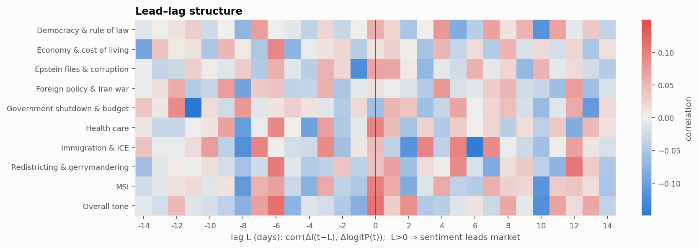

* The cross-correlation function peaks at **lag 0** for the composites; no lead at 1–14 days is systematic.
* **Granger causality:** sentiment → market is not significant after FDR correction for any index (smallest q = 0.075, for immigration). In the reverse direction, market → health-care sentiment has p = 0.04.
* **Out-of-sample** (expanding-window ridge forecasts of Δlogit P one day ahead, from sentiment changes over the past 0–2 days, compared with the prevailing-mean forecast):

| Predictors | OOS R² | Clark–West p |
|---|---|---|
| MSI | 0.41% | 0.095 |
| Overall tone | 0.51% | 0.094 |
| Top-4 issues | −2.4% | 0.55 |
| All 8 issues | −3.8% | 0.46 |
| AR(3) own lags | 0.25% | 0.22 |

H2 is supported: there is no economically meaningful predictability, and adding issues only adds estimation noise. *Methodological note:* before the Polymarket timestamps were re-labelled (§1), the same test produced an OOS R² of 0.9% with p = 0.04. That "signal" was entirely the one-day misalignment leaking same-day co-movement into the forecast. Aligning clocks correctly is the difference between a publishable-looking false positive and the true null.

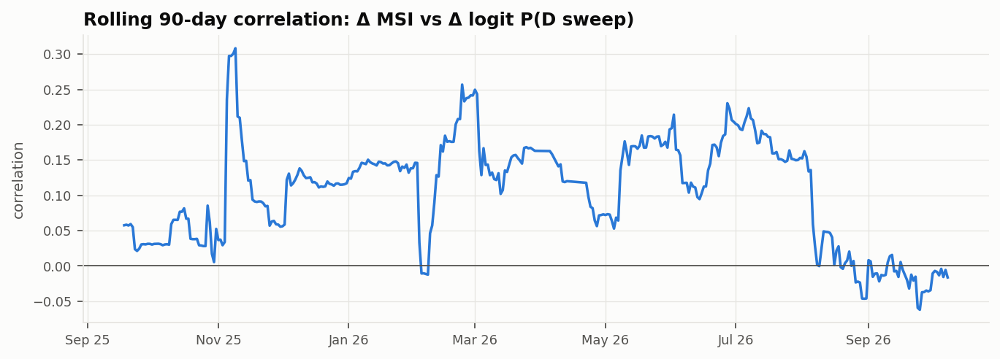

### 4.5 Robustness (daily Δ correlation with Δ logit P)

| Index | Baseline | VADER | Kalshi target | News only | Social only | Excl. 10 largest moves | Half-life 1d / 7d |
|---|---|---|---|---|---|---|---|
| MSI | 0.100 | 0.072 | 0.064 | — | — | 0.077 | — |
| Overall tone | 0.112 | 0.088 | 0.071 | — | — | 0.097 | — |
| Health care | 0.096 | 0.105 | **−0.045** | 0.051 | 0.133 | 0.075 | 0.123 / 0.101 |
| Redistricting | 0.042 | 0.027 | −0.009 | 0.006 | 0.133 | 0.110 | 0.075 / 0.090 |
| Epstein | 0.068 | 0.027 | 0.084 | 0.028 | 0.112 | 0.030 | 0.109 / 0.082 |

The composites stay in the 0.06–0.11 range under every specification, so the small positive co-movement is robust. Single-issue results are fragile: the health-care result flips sign against Kalshi. The social channel carries most of the signal.

---

## 5. The mid-term equity basket

### 5.1 Construction (ex-ante, thesis-driven)

The basket's policy logic is simple. A Democratic Congress cannot legislate over a presidential veto, but it **controls appropriations, oversight and shutdown leverage**, and it blocks any further reconciliation packages.

| Expected **beneficiaries** of a Democratic sweep (long) | Expected **losers** (short) |
|---|---|
| Clean energy (FSLR, ENPH, RUN, NEE, PLUG): slower erosion of IRA credits | Immigration detention (GEO, CXW): ICE appropriations and oversight |
| Medicaid / ACA insurers (CNC, MOH, OSCR): coverage and subsidy fights | Political brand (DJT); crypto deregulation (COIN, HOOD) |
| Hospitals (HCA, THC): uncompensated-care exposure | Firearms (RGR, SWBI); fossil fuels (XOM, BTU); defense plus-ups (LMT) |

**Market adjustment:** $AR_{it} = r_{it} - \hat\beta_i r_{SPY,t}$, using Blume-adjusted betas estimated on Jul 2024 – Jul 2025. That window is strictly before the study window, so the betas are not contaminated by the political shock being measured. **Sweep beta:** $AR_{it} = a_i + \gamma_{0i}\,\Delta L_t + \gamma_{1i}\,\Delta L_{t-1} + e_{it}$, where $L$ = logit P(sweep) sampled at **16:00 ET** from hourly Polymarket data. HAC(5) errors are used, and the reported total is $\gamma_0 + \gamma_1$.

### 5.2 Results (H3)

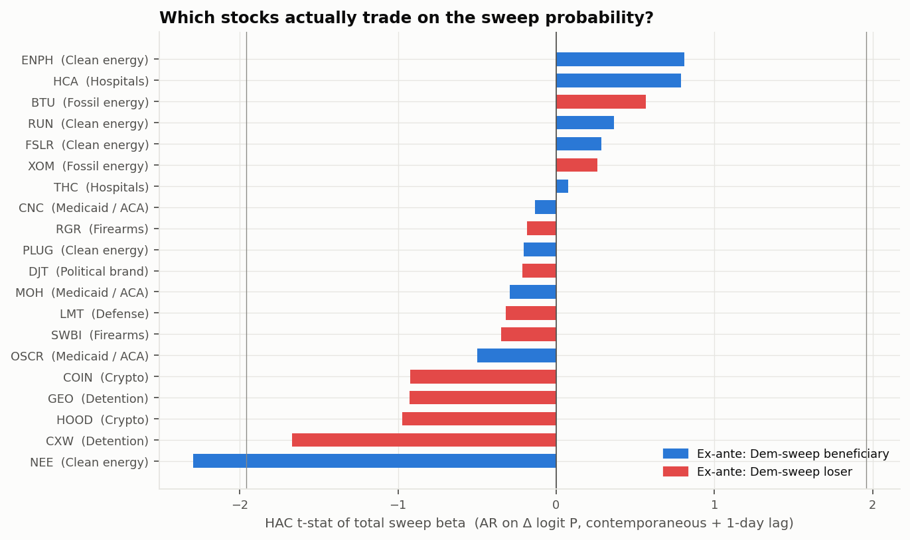

* **Thesis signs:** 13 of 20 are correct (binomial p = 0.13). Only **one** stock is significant at 5%, and it has the *wrong* sign: **NEE (t = −2.3)**. NEE's moves are dominated by rate sensitivity and AI-driven power demand, not IRA politics. The best-behaved thesis name is **CXW** (t = −1.7, consistent with the thesis in both halves).
* **Sign instability.** The Medicaid / ACA names flip: CNC has t = +2.7 in-sample and t = −2.3 out-of-sample, and OSCR goes from +0.9 to −2.1. Their sweep exposure in the shutdown / subsidy fight of late 2025 did not persist into 2026.

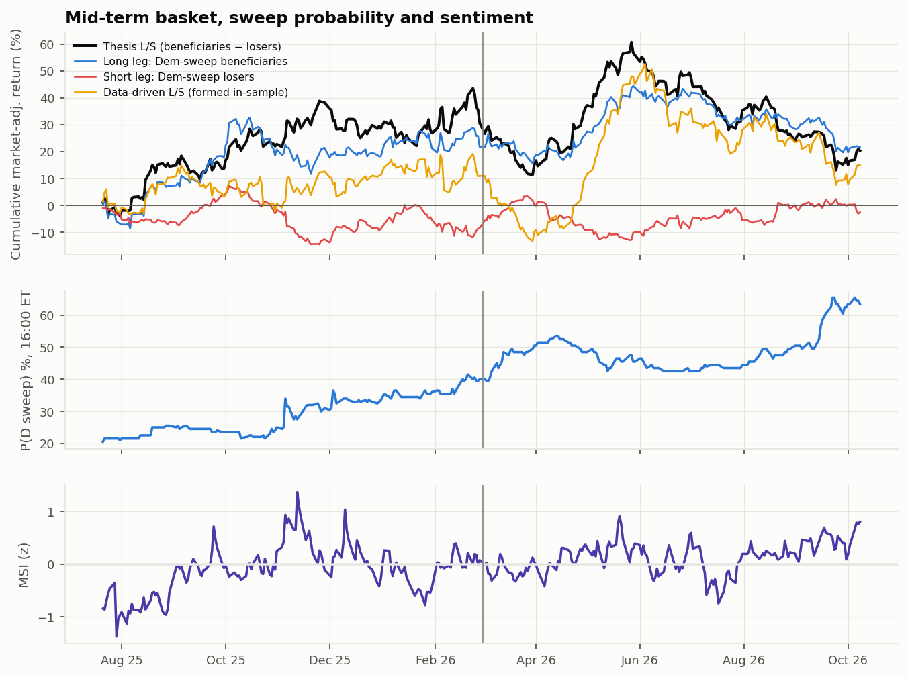

| Basket | Sample | corr(AR, ΔL) | Sweep β (t) | Annualised AR | Sharpe |
|---|---|---|---|---|---|
| Thesis L/S | In-sample (Jul 25 – Feb 26) | 0.10 | 0.065 (**1.61**) | +54.6% | 1.53 |
| Thesis L/S | Out-of-sample (Mar – Oct 26) | −0.03 | −0.030 (−0.73) | −12.5% | −0.36 |
| Thesis L/S | Full | 0.05 | 0.024 (0.67) | +16.3% | 0.66 (t = 0.73) |
| Long leg only | In-sample | 0.17 | γ₀ t = **2.60** | +37.8% | 1.21 |
| Data-driven L/S (top/bottom 5 by in-sample γ) | In-sample | 0.13 | 0.141 (**3.27**) | — | — |
| Data-driven L/S | Out-of-sample | −0.02 | −0.082 (−1.56) | +5.9% | 0.34 |

* **Early on, the trade worked.** In the first half, the long leg (clean energy and health care) rose on days when Democratic odds rose (γ₀ t = 2.6), and the long–short basket had gained **+31%** in market-adjusted terms by the split. Out-of-sample the link broke: the basket rallied to **+61% (27 May 2026)** and then round-tripped to **+20%** by October, with essentially zero correlation with the sweep probability (−0.03), even as P(sweep) climbed from 40% to 63%. The basket's large swings were driven by something other than midterm odds.
* **Overfitting is visible.** Choosing names by in-sample sweep beta mechanically produces t = 3.3, which becomes t = −1.6 out-of-sample. This is a textbook illustration of why the ex-ante basket is the primary test.
* **Event study** on the 10 largest 16:00-ET probability shocks: the mean signed basket abnormal return is insignificant (t = 0.86, p = 0.41). The largest single shock (5 Nov 2025, +9 pp, Democrats' off-year sweep plus Prop 50) gave a basket return of only +1.3%, about 0.6σ.
* **Factor controls** (Fama–French 5 + momentum, raw L/S returns through Aug 2026): alpha is 12.8% annualised (t = 0.43); the only notable loading is a residual market exposure (0.34, t = 1.9); and the sweep loading after controls has **t = 0.83**.

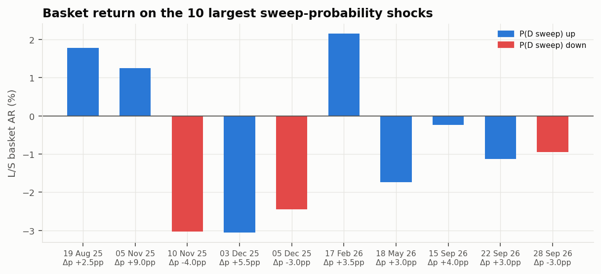

**Power, so the null is not over-read.** The standard error of the basket's sweep beta is 0.036. With 80% power at 5% significance, the minimum detectable γ is about 0.10. Multiplied by the 1.9-unit logit move over the window, that is a **minimum detectable cumulative abnormal return of about 19%**. We can rule out that this basket was a strong, persistent "midterm factor". We **cannot** rule out moderate exposures of 5–10% over the campaign.

### 5.3 Sentiment ↔ basket (H4)

No index is significantly related to basket abnormal returns: all |t| < 1.8, the daily correlation of the composite is −0.01, and the weekly correlation is 0.09. Controlling for ΔL changes nothing. The only Granger p-value below 0.05 (democracy sentiment → basket, p = 0.016) does not survive correction across 10 tests. The composite's *level* correlates 0.46 with the basket's cumulative abnormal return, but that is the same drifting-series artefact as in §4.3.

**Performance appraisal of a tradable overlay** (CIPM measures, out-of-sample, position set at the prior close): going long or short the basket on the sign of the 5-day MSI change (sign estimated in-sample) gives an annualised return of −7.9%, a Sharpe ratio of −0.17, a maximum drawdown of −15%, and an information ratio of only +0.13 against buy-and-hold (Sharpe −0.36). A probability-momentum overlay does worse (Sharpe −0.50). These figures exclude costs, and borrow costs on GEO, CXW and DJT would make them worse. **There is no tradable edge.**

---

## 6. Conclusions

1. **Voters' issue: the economy, by a wide margin.** The *discourse*, however, is about democracy, redistricting and scandal. Unsupervised topic models recover the *ordering* of issue importance (ρ = 0.85 with an independent market) but not the *levels*, because online and media attention over-weights process and scandal issues that matter to engaged partisans. Anyone using text volume as a measure of issue importance should calibrate it against a survey or market anchor.
2. **Topic sentiment is a coincident indicator, not a leading one.** It moves on the same news as the event-contract price, with a correlation of about 0.10 daily and 0.20 weekly, concentrated in the House contract. It contains no out-of-sample information once the price is observed. This is H2 in its strong form: the Polymarket sweep book is weak-form efficient once it matures, and the information NLP extracts is already in the price.
3. **The sign is informative about the measurement, not just the market.** Positive tone goes with Democratic gains because the corpus measures *how Democratic-leaning audiences and headline writers feel*. The referendum channel appears only for the economy, at weekly frequency. A stance-aware ("sentiment toward the governing party on issue *k*") index is the right next step.
4. **The midterm equity trade was not priced in this cycle.** The thesis basket's early co-movement with Democratic odds did not survive out-of-sample. The most plausible economic explanation is that a Democratic sweep under a Republican president means **gridlock rather than legislation**. Policy effects run through appropriations, oversight and shutdown risk, which are diffuse and partly bipartisan, so the expected cash-flow impact on any single sector is modest. On top of that, the probability drifted (it was anticipated) rather than jumped, and much larger macro shocks (the Iran war and oil, tariffs, AI capex) dominated the cross-section.
5. **Practical recommendation.** Use the event-contract price (logit, 16:00-ET aligned) as the political state variable. Use NLP to *attribute* its moves to issues and events and to monitor salience. Pre-register the equity test for **election night**, when about 1.9 logit units of residual uncertainty resolve in a single print. That raises statistical power by more than an order of magnitude compared with a year of small daily moves.

---

## 7. Limitations and threats to validity

* **Platform skew (the largest).** Bluesky is heavily left-leaning; X, Truth Social and Facebook were not accessible free of charge. Per-channel z-scoring and change-based tests reduce the *level* bias, but cannot fix the fact that we measure the *mood of one coalition*. News headlines partly balance this (Fox, Newsweek and The Hill are among the top sources), but headline tone is an editorial artefact.
* **Sampling.** `sort=top` with at most 100 posts per query per day yields an engagement-ranked sample, not a random one. Google News ranking is opaque. Retrieval queries were issue-agnostic but are still a design choice (they pulled in non-US elections and student "midterm" exams, which were filtered out as off-topic topics).
* **Sentiment ≠ stance.** Document-level sentiment ignores the target (anger *at* the administration and anger *at* Democrats score the same). There was no human-labelled validation set; RoBERTa–VADER agreement (ρ = 0.47 at the document level) is a consistency check, not a measure of accuracy. Aspect- or target-based models (as in FinXABSA or SEntFiN) would be better.
* **Annotation subjectivity.** The topic → issue map is one annotator's judgement (an LLM). Agreement with the automatic method is moderate (κ = 0.59). The full map is published so that it can be audited and changed.
* **Validation market.** Kalshi's exit-poll issue market opened on 24 Sep 2026, is thin ($4–13k per contract), and lists only 7 categories. ρ = 0.85 rests on n = 7.
* **Sample size and power.** 447 days in one election cycle means about 64 independent weeks, so the standard error of a weekly correlation is 0.125. Effects of 0.1–0.2 are therefore at the edge of detectability, and the equity tests can only rule out large effects (§5.2).
* **Researcher degrees of freedom.** The basket and its signs come from an analyst's policy priors. The 1 Mar 2026 split, the 3-day half-life and the 0.50 outlier threshold are single choices; robustness to the half-life is shown, and to the threshold in the clustered-only shares. The data-driven basket demonstrates how easily in-sample "political beta" can be manufactured.
* **Microstructure.** Polymarket's daily prints are snapshots, not VWAPs. Kalshi mid-quotes can be stale on quiet days. Hourly sampling at 16:00 ET still leaves minute-level asynchrony with the equity close.
* **Factor data** end on 31 Aug 2026; the factor regression omits the final 5 weeks.

## 8. Extensions

1. **Election-night event study** (pre-registered): basket abnormal return on 4 Nov 2026 against the realised Δlogit P.
2. **Stance detection** with an instruction-tuned LLM ("who is blamed or credited on issue *k*?") to build party-attributed issue indices; a referendum test on economy *blame*.
3. **Cross-platform sentiment** (X via a paid API, Truth Social, Reddit) to estimate an ideology-balanced index, and to test whether *cross-coalition divergence*, not tone, predicts the market.
4. A **time-series transformer** or VAR with exogenous news shocks, and **contract-level decomposition** (P(sweep) = P(House)·P(Senate | House)) to separate chamber-specific information.

---

## References

* Aloosh, A., Choi, H.-E., & Ouzan, S. (2023). *The Tail Wagging the Dog: How Do Meme Stocks Affect Market Efficiency?* SSRN 3839832. (Efficiency battery: Ljung–Box, variance ratio, runs, Bartels; subsample efficiency.)
* Du, K., Zhao, Y., Mao, R., Xing, F., & Cambria, E. (2025). Natural language processing in finance: A survey. *Information Fusion*, 115, 102755. (Domain-matched sentiment models, LLM annotation, XAI and robustness.)
* Kherwa, P., & Bansal, P. (2019). Topic Modeling: A Comprehensive Review. *EAI Endorsed Trans. Scalable Information Systems*, 7(24). (LSA/NMF/LDA, coherence evaluation, the stability challenge.)
* Wilcox, S., Aw, E., Simaan, Y., & Sivin, G. (2014). Investment Performance Appraisal. CFA Institute, CIPM Reading 9. (Sharpe, Sortino, Calmar, information ratio; Fama–French/Carhart alpha; skill vs luck.)
* Grootendorst, M. (2022). BERTopic: Neural topic modeling with a class-based TF-IDF procedure. arXiv:2203.05794.
* Loureiro, D. et al. (2022). TimeLMs: Diachronic language models from Twitter. ACL demo (`twitter-roberta-base-sentiment-latest`).
* Lo, A., & MacKinlay, C. (1988). Stock market prices do not follow random walks. *RFS*, 1(1). · Clark, T., & West, K. (2007). Approximately normal tests for equal predictive accuracy in nested models. *J. Econometrics*, 138. · Politis, D., & Romano, J. (1994). The stationary bootstrap. *JASA*, 89. · Benjamini, Y., & Hochberg, Y. (1995). *JRSS-B*, 57. · Wagner, A., Zeckhauser, R., & Ziegler, A. (2018). Company stock price reactions to the 2016 election shock. *JFE*, 130.
